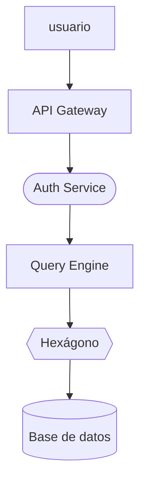

# NebulaDB

> Base de datos distribuida de alto rendimiento diseñada para aplicaciones que necesiten consultas rápidas, escalabilidad horizontal y tolerancia a fallos.

  


  

## Índice

- [NebulaDB](#nebuladb)
  - [Índice](#índice)
  - [Arquitectura](#arquitectura)
  - [Tabla de componentes](#tabla-de-componentes)
  - [Instalación](#instalación)
  - [Diagrama](#diagrama)
  - [Enlaces](#enlaces)
  - [Imagen](#imagen)
  - [Lista de tareas](#lista-de-tareas)
  - [Licencia](#licencia)

  

## Arquitectura

- API Gateway

- Componente de entrada única de NebulaDB que recibe todas las peticiones de los clientes y las enruta al servicio correspondiente, aplicando seguridad, validación y balanceo de carga.

  

- Auth Service

- Servicio encargado de gestionar la identidad y el acceso en NebulaDB, validando credenciales, emitiendo tokens y administrando roles y permisos.

  

- Query Engine

- Motor central de NebulaDB que interpreta, optimiza y ejecuta las consultas, decidiendo qué nodos consultar y consolidando los resultados.

  

- Storage Nodes

- Nodos distribuidos que almacenan físicamente los datos de NebulaDB, replicándolos para tolerancia a fallos y permitiendo el escalado horizontal.

- Monitoring

- Sistema transversal que observa la salud de NebulaDB, recopilando métricas, logs y trazas, y generando alertas ante anomalías.

  
  

## Tabla de componentes

| Componente | Lenguaje | Estado | Versión | Dependencia |
|:-----------|:--------:|-------:|--------:|:------------|
| API Gateway | Go | Estable | 2.4.1 | Redis`<br>`Prometheus|
|Auth Service| Rust | Estable| 2.3.0 | PostgreSQL`<br>`JWT|
|Query Engine| C++| Beta| 3.0.0| Grpc`<br>`LLVM|
|Storage Node| Rude| Estable| 4.1.2|RocksDB`<br>`Raft|
|Monitoring| Python| Experimental| ---| Prometheus`<br>`Granafa|

## Instalación
Clona el repositorio y ejecuta el instalador
```bash
git clone https://example.com/nebuladb.git
cd nebuladb
./install.sh
```
Comprueba que la instalación se ha realizado correctamente
```bash
nebuladb --version
```

## Diagrama

## Enlaces
[documentación avanzada](https://example.com/advanced)

[soporte@nebuladb.com](mailto:soporte@nebuladb.com)


## Imagen


## Lista de tareas
- [x] Diseñar la arquitectura inicial.
- [x] Implementar el API Gateway.
- [x] Implementar la autenticación JWT.
- [ ] Añadir replicación automática.
-  [ ] Implementar consultas distribuidas.
- [ ] Crear panel de monitorización.
- [ ] Publicar la versión 3.0.
---
> "Construimos NebulaDB para que la complejidad de la infraestructura no tenga que ser visible para quien desarrolla aplicaciones."
>
> — Equipo de NebulaDB

**Última actualización:** 1 de octubre de 2026
## Licencia
NebulaDB se distribuye bajo la licencia **Apache License 2.0**.
Consulta el texto completo de la licencia en Apache License 2.0.