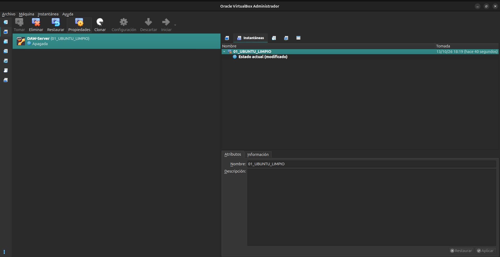

# Configuration guide for ubuntu-server
** In this guide we are going to configure our ubuntu-server step by step so anyone reading this can do it.**

## Basic configuration
### 1. Update the packages
If we are already on our virtual machine, the first thing we are gonna do is open the terminal. Once we have our terminal ready, we can start the configuration.

This is the command to update the packages:
```bash
sudo apt update
```

### 2. Update the operating system
Now continuing with our virtual machine configuration, now we will update our operating system.
This is the command:
```bash
sudo apt upgrade -y
```

And we update the packages again (just in case). You should receive "All packages are up to date":
```bash
sudo apt update
```

### 3. Reboot the server
Now we reboot our virtual machine.
This is the command:
```bash
sudo reboot
```
That should reboot our virtual machine, so we will need to enter our username and password again.

### 4. Check the name of the server
Now, to check command to check the name of our server is:
```bash
hostname
```
### 5. Check the version
Moving forward, now we are going to check the version of our operating system.
This is the command:
```bash
lsb_release -a
```
### 6. Install basic tools
To continue with, on this step we are going to install some network tools alongside some other tools that are pretty useful.
This is the command:
```bash
sudo apt install -y curl wget git vim nano unzip tree net-tools htop
```
#### 6.1 The tools
Let's take a moment to see and explain briefly all the installed tools:
- **curl**:  A command-line tool for transferring data with URLs. Used to make HTTP/FTP/etc. requests from the terminal (download files, test APIs, etc.).
- **wget**: A file downloader for the web. Similar to curl but more focused on simple and recursive downloads.
- **git**: A distributed version control system. Lets you manage repositories, commits, branches, and collaborate on code projects.
- **vim**: A modal text editor for the terminal. Very powerful and configurable, with different modes (normal, insert, visual).
- **nano**: A simple terminal text editor. Easier to use than vim, great for quick edits.

- **unzip**: Utility to extract files from `.zip` archives.
- **tree**: A tool that let you display the directory structure as a hierarchical tree.
- **net-tools**: It is a collection of classic networking tools.
- **htop**: Interactive process and system resource monitor (CPU, RAM...).

### 7. Check git version
To check the git version of our git we can:
```bash
git --version
```

### 8. Check the network connection
Now, to check the network connection, we are going to run 2 commands.
The first one shows the net interfaces, their ip's and thei mac's:
```bash
ip a
```

The second one shows how the packets leave the system(routing table):
```bash
ip route
```

### 9. Check SSH service
We want to check the status of our ssh service
```bash
sudo systemctl status ssh
```

If we do not have ssh, we are gonna install it, enable it, and check the status:
```bash
#installation
sudo apt install -y openssh-server

#enable it
sudo systemctl enable --now ssh

#check the status
sudo systemctl status ssh
``` 

### 10. Check ports
Now we are gonna check which ports is ssh using, assuming it is enabled and functioning correctly:
```bash
sudo ss -tulpn
```

### 11. Check the user
If we wanna know which user you currently are, execute this command:
```bash
whoami
```

### 12. Check groups
If we wanna know which groups does the current user belong to, execute:
```bash
groups
```

### 13. Configure the firewall
First we are checking the status of the ufw (Ubuntu Firewall) service:
```bash
sudo ufw status
#At first it should show 'inactive'
```

#### 13.1 Before activating it
```bash
#Gives permission to ssh
sudo ufw allow ssh

#Enable it
sudo ufw enable

#Shows the status
sudo ufw status
```

### 14. After we finished
Once we finished all the configuration, we are gonna shutdown our virtual machine. On the menu of virtual box we are gonna go and take an snapshot of our current virtual machine and save it as 01_UBUNTU_LIMPIO. 
