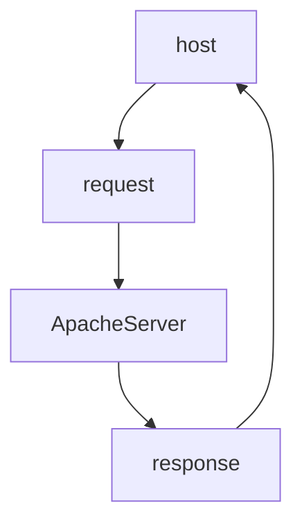

# Apache web server
__This is a guide on how to install apache server on our ubuntu server virtual machine__

## 1. Diagram of the architecture


## 2. Previous steps
We check our user, and ip
```bash
#Check the user
whoami
#Check de ip address
ip a
```
## 3. Update ubuntu
We update our system
```bash
sudo apt update
```

## 4. Begin the installation
We start installing apache on our virtual machine
```bash
sudo apt install apache2
#Answer Y to the question
```
## 5. Checking apache
We check the status of our apache service
```bash
sudo systemctl status apache2
```
You should see this "active(running)":


That means that the service is operative and functioning correctly.

Now we are going to check Apache starts running once our server is running
```bash
sudo sytemctl is-enabled apache2
#You should get enabled
```

## 6. Using systemctl
```bash
#To stop the service
sudo systemctl stop apache2
#Now we check the status
sudo systemctl status apache2

#To start again the service
sudo systemctl start apache2
#Now we check the status
sudo systemctl status apache2

#To reload the service
sudo systemctl reload apache2
```
 Por un lado __systemctl reload__ carga la nueva configuración del servicio, pero sin interrumpir peticiones que estuviesen usando la configuración antigua.
Por otro lado __systemctl start__ inicia el servicio desde 0, dandole igual las antiguas conexiones/peticiones en curso que hubiese antes.

## 7. Apache port
Now I am going to check that the port from our server has the "LISTEN" status
```bash
sudo netstat -tulpn
```
This is what you should get:


If you look closely, you will see the apache service.

### What we can see
- The port number used by apache 80
- It is using the tcp6 protocol
-  Status "LISTEN", significa que esta a la espera de nuevas peticiones y que esta mirando si hay alguna.
