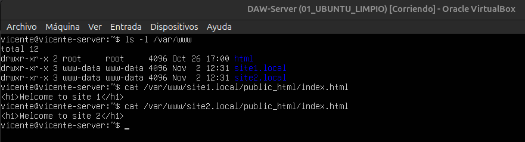
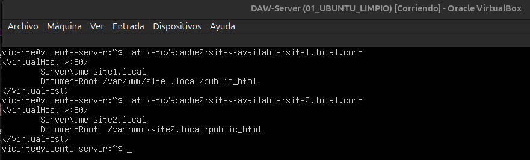
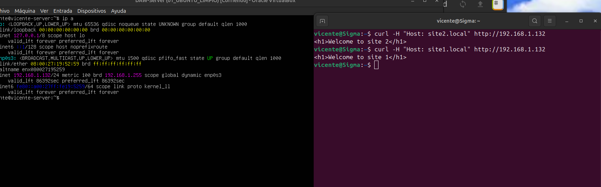

# Virtual host

## The virtual host and his advantages

### What it is?
A virtual host is a a method used to host multiple websites on a single physical server. 

From the visitor perspective, It may seem that each web is located on its own dedicated server, but in reality all the websites are sharing the hardware resources of one machine, the server.

### What advantages does it have?
- **Cost and resource efficiency**
- **Centralized management**
- **Flexibility**

## Creating two virtual hosts in Apache

```bash
# Create directories
sudo mkdir -p /var/www/site1.local/public_html
sudo mkdir -p /var/www/site2.local/public_html

# Create a test index.html for each site
echo "<h1>Welcome to site 1</h1>" | sudo tee /var/www/site1.local/public_html/index.html
echo "<h1>Welcome to site 2</h1>" | sudo tee /var/www/site2.local/public_html/index.html

# Change ownership from root to the web server user
sudo chown -R www-data:www-data /var/www/site1.local
sudo chown -R www-data:www-data /var/www/site2.local
```
And we check if everything went well:
```bash
#Check the owner and group of the folders
ls -l /var/www

#Check the index.html content and if it exists
cat /var/www/site1.local/public_html/index.html
cat /var/www/site2.local/public_html/index.html
```


## Creating .conf files
Now on each host we are gonna create a .conf file, needed for the correct function of the site.
```bash
#Creates and enters to edit the .conf file
sudo nano /etc/apache2/sites-available/site1.local.conf
```

Once it is created and you are in, we will write this
```apache
<VirtualHost *:80>
ServerName site1.local
DocumentRoot /var/www/site1.local/public_html
</VirtualHost>
```

We do the exact same thing for the second host

```bash
#Creates and enters to edit the .conf file
sudo nano /etc/apache2/sites-available/site2.local.conf
```

Once it is created and you are in, we will write this
```apache
<VirtualHost *:80>
ServerName site2.local
DocumentRoot /var/www/site2.local/public_html
</VirtualHost>
```

To check the files and its content, we can:
```bash
cat /etc/apache2/sites-available/site1.local.conf
cat /etc/apache2/sites-available/site2.local.conf
```


## Enable both sites
Now that we have the configuration for both sites, let's enable them.
```bash
#Enables site 1 and site 2
sudo a2ensite site1.local.conf
sudo a2ensite site2.local.conf

#Disable the default site so it doesn't interfere
sudo a2dissite 000-default.conf

# Checks if the conf file are valid
sudo apache2ctl configtest

# Reloads the apache service
sudo systemctl reload apache2
```

And we add the two new sites on the following file:
```bash
#Open to edit the file hosts
sudo nano /etc/hosts
```

Add those two lines to the file
```
127.0.0.1 site1.local www.site1.local
127.0.0.1 site1.local www.site2.local
```

Once we have everything done, if we wanna check if the sites responds, we can test it, and Im gonna test from the host machine.
run on your terminal of your host machine(or other machine that isn't the server and shares the same network)

Ubuntu/Linux
```bash
curl -H "Host: site1.local" http://192.168.1.132
curl -H "Host: site1.local" http://192.168.1.132
```

Windows
```powershell
curl -H 'Host: site1.local' http://192.168.1.132
curl -H 'Host: site2.local' http://192.168.1.132
```


